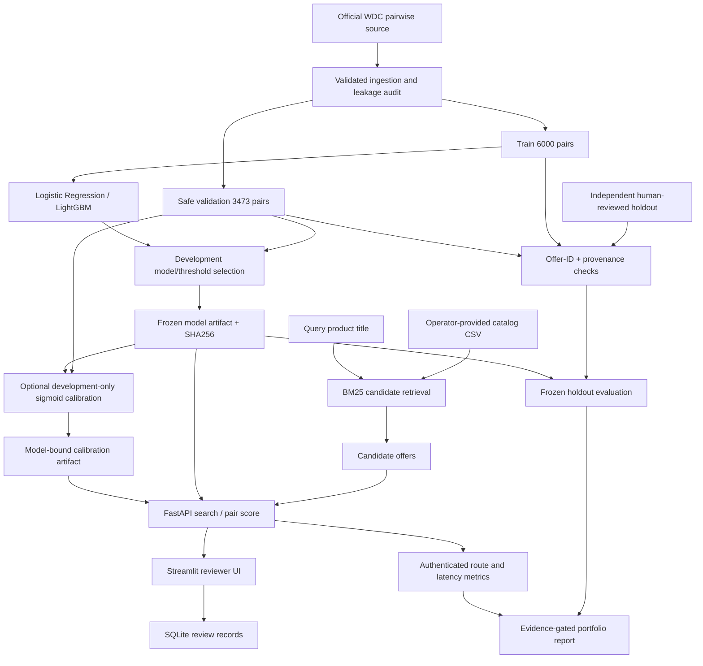

# ProductMatch AI — System architecture

The following is an implementation architecture, not proof of cloud
hosting or end-to-end benchmark quality.

## Key boundaries

1. **Train:** fit predictive model only using the WDC training pairs.
2. **Development:** the safe validation set is used for model and threshold
   selection; its optional calibration is *not* independently validated.
3. **Sealed WDC tests:** neither official seen nor unseen test split is
   opened in the development/calibration/evidence pipeline.
4. **External evaluation:** independently collected labeled offers must
   pass ID-disjointness checks against both development splits. Source
   independence and label quality require manual audit.
5. **Serving:** local-only operator-selected model artifacts and catalog.
   Authentication is mandatory; human reviews do not retrain models.
6. **Operational evidence:** counts/latency only, avoiding product titles,
   identifiers, API keys and reviewer comments.
